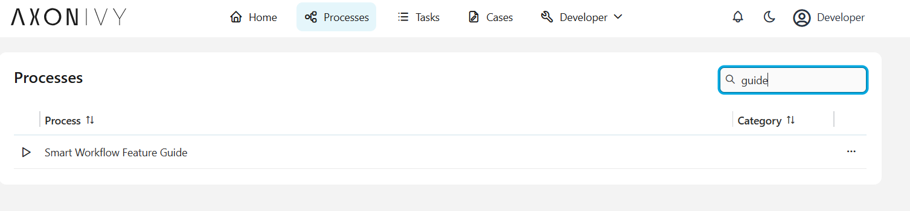
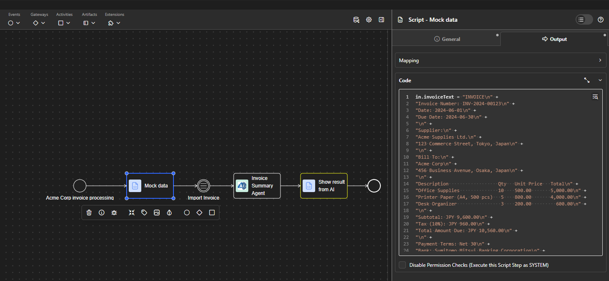
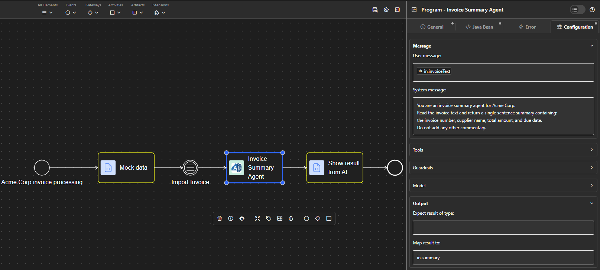
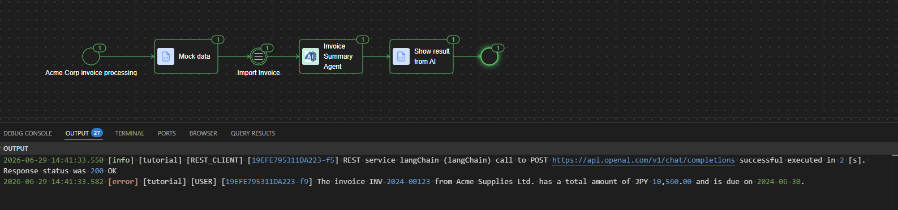

# Axon Ivy Smart Workflow Tutorial

---

## English

This is a tutorial project for **Axon Ivy Smart Workflow** developers. It is intended for developers who have foundational knowledge of Java and experience developing Axon Ivy projects.

### Prerequisites

- Java development experience
- Familiarity with Axon Ivy project development

### Versions

| Component | Version |
|---|---|
| Axon Ivy Engine | [Axon Ivy Engine 14.0.1](https://download.axonivy.com/14.0.1/AxonIvyEngine14.0.1.2610231214_Slim_All_x64.zip) |
| Smart Workflow | 14.0.0 (resolved from [maven.axonivy.com](https://maven.axonivy.com)) |

### Project Structure

```
tutorial-repo/
├── best-practices/  # Best-practice exercise Axon Ivy project
├── internal/        # Internal builder for the Feature Guide walkthroughs (not an Axon Ivy project; do not change)
└── tutorial/        # Tutorial Axon Ivy project
```

### Smart Workflow Feature Guide

The Feature Guide is an interactive documentation viewer built into the tutorial project. To open it, go to the Process list in Axon Ivy Designer and start the **Smart Workflow Feature Guide** process.



Tutorials with an interactive simulation have a **Walkthrough** button next to their title. These are the feature tutorials 01 to 07, 09 to 13, 15 and 17. It opens a simulated Process Designer full screen: a walkthrough plays the process by itself and explains each setting, after which you can select an element, edit its configuration and run the process yourself. It runs offline and the model's answers are simulated, so it needs neither a network connection nor an API key.

### Interactive App Builder (internal)

[`internal/interactive_app_builder`](internal/interactive_app_builder/README.md) is the internal builder for the **Walkthrough** simulations of the Feature Guide. It is a Node.js tool, not an Axon Ivy project, and has nothing to do with Axon Ivy itself: neither the Designer nor the Engine uses it, and you do not need it to follow the tutorials. The scripts it generates are already part of the tutorial project (`tutorial/webContent/resources/js/`). It is in this repository only for transparency, so that you can see how the walkthroughs are made.

> **Please do not change this folder or the scripts it generates.** It is maintained internally, only to build the walkthroughs.

### Tutorial Processes

Each feature in the `tutorial` project has a dedicated demo process that you can run directly in the Designer. Every process follows the same structure:

**Mock data element** — Pre-fills the process input so you can run the process without any manual data entry. Modify the values inside to test the agent with your own data.



**Agent element** — The `AgenticProcessCall` element containing the AI configuration for that feature: system message, user message, provider, tools, guardrails, and result mapping. Double-click it to inspect or change the configuration.



**Show result element** — Logs the agent's response to the Axon Ivy Runtime Log after each run. To inspect the output, open the **Output** tab in the Designer and switch to the **Axon Ivy Runtime Log** view.



### Export Documentation

The Feature Guide includes an **⬇ Export** button in the navigation bar. Clicking it downloads a `tutorial-docs.zip` file containing all feature documentation and images as standalone Markdown files — ready to read in any Markdown viewer or share without an Axon Ivy runtime.

The ZIP has the following structure:

```
tutorial-docs.zip
├── en/
│   ├── feature-01.md … feature-18.md
│   ├── practice-01.md … practice-05.md
│   └── appendix-01.md … appendix-06.md
├── jp/
│   ├── feature-01.md … feature-18.md
│   ├── practice-01.md … practice-05.md
│   └── appendix-01.md … appendix-06.md
└── images/
    └── *.png
```

All `cms:/` image references in the markdown files are automatically rewritten to relative paths (`../images/xxx.png`) so images render correctly when opened locally.

---

## 日本語

これは **Axon Ivy Smart Workflow** 開発者向けのチュートリアルプロジェクトです。Java の基礎知識と Axon Ivy プロジェクト開発の経験を持つ開発者を対象としています。

### 前提条件

- Java 開発の経験
- Axon Ivy プロジェクト開発の知識

### バージョン

| コンポーネント | バージョン |
|---|---|
| Axon Ivy Engine | [Axon Ivy Engine 14.0.1](https://download.axonivy.com/14.0.1/AxonIvyEngine14.0.1.2610231214_Slim_All_x64.zip) |
| Smart Workflow | 14.0.0（[maven.axonivy.com](https://maven.axonivy.com) から取得） |

### プロジェクト構成

```
tutorial-repo/
├── best-practices/  # ベストプラクティス演習用 Axon Ivy プロジェクト
├── internal/        # フィーチャーガイドのウォークスルー用の内部ビルダー（Axon Ivy プロジェクトではありません。変更しないでください）
└── tutorial/        # Axon Ivy チュートリアルプロジェクト
```

### Smart Workflow フィーチャーガイド

フィーチャーガイドは、チュートリアルプロジェクトに組み込まれたインタラクティブなドキュメントビューアーです。開くには、Axon Ivy Designer のプロセス一覧から **Smart Workflow Feature Guide** プロセスを起動してください。


インタラクティブなシミュレーションを備えたチュートリアルには、タイトルの横に **ウォークスルー** ボタンがあります。対象は機能チュートリアルの 01〜07、09〜13、15、17 です。クリックすると Process Designer のシミュレーションが全画面で開き、ウォークスルーがプロセスを自動で実行しながら各設定を解説します。その後は要素を選択し、設定を編集して、自分でプロセスを実行できます。オフラインで動作し、モデルの回答はシミュレーションのため、ネットワーク接続もAPIキーも不要です。

### インタラクティブアプリビルダー（内部用）

[`internal/interactive_app_builder`](internal/interactive_app_builder/README.md) は、フィーチャーガイドの **ウォークスルー** を生成する内部用のビルダーです。Node.js のツールで、Axon Ivy のプロジェクトではなく、Axon Ivy 自体とは関係ありません。Designer も Engine もこれを使用せず、チュートリアルを進めるためにも必要ありません。生成されたスクリプトは、すでにチュートリアルプロジェクト（`tutorial/webContent/resources/js/`）に含まれています。このフォルダーは、ウォークスルーの作り方を確認できるよう、透明性のためだけにリポジトリに含めています。

> **このフォルダーと、生成されたスクリプトは変更しないでください。** ウォークスルーをビルドするためだけに、内部で管理しています。

### チュートリアルプロセス

`tutorial` プロジェクトの各フィーチャーには、Designer から直接実行できる専用のデモプロセスがあります。すべてのプロセスは同じ構成に従っています。

**Mock data 要素** — プロセスの入力をあらかじめ設定するため、手動でのデータ入力なしにプロセスを実行できます。内部の値を変更することで、独自のデータを使ってエージェントをテストできます。


**エージェント要素** — そのフィーチャーの AI 設定（システムメッセージ・ユーザーメッセージ・プロバイダー・ツール・ガードレール・結果マッピング）を含む `AgenticProcessCall` 要素です。ダブルクリックして設定の確認や変更ができます。


**Show result 要素** — 実行のたびにエージェントの応答を Axon Ivy Runtime Log に記録します。出力を確認するには、Designer の **Output** タブを開き、**Axon Ivy Runtime Log** ビューに切り替えてください。


### ドキュメントのエクスポート

フィーチャーガイドのナビゲーションバーには **⬇ Export** ボタンがあります。クリックすると `tutorial-docs.zip` ファイルがダウンロードされます。このファイルにはすべてのフィーチャードキュメントと画像がスタンドアロンの Markdown ファイルとして含まれており、Axon Ivy ランタイムなしで任意の Markdown ビューアーで閲覧したり共有したりできます。

ZIP の構成は以下の通りです。

```text
tutorial-docs.zip
├── en/
│   ├── feature-01.md … feature-18.md
│   ├── practice-01.md … practice-05.md
│   └── appendix-01.md … appendix-06.md
├── jp/
│   ├── feature-01.md … feature-18.md
│   ├── practice-01.md … practice-05.md
│   └── appendix-01.md … appendix-06.md
└── images/
    └── *.png
```

Markdown ファイル内の `cms:/` 画像参照はすべて相対パス（`../images/xxx.png`）に自動変換されるため、ローカルで開いても画像が正しく表示されます。
